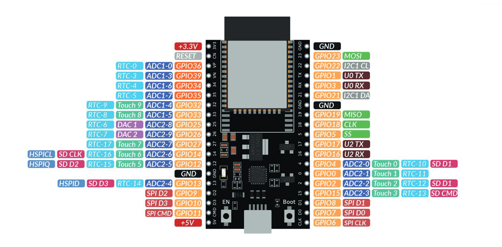
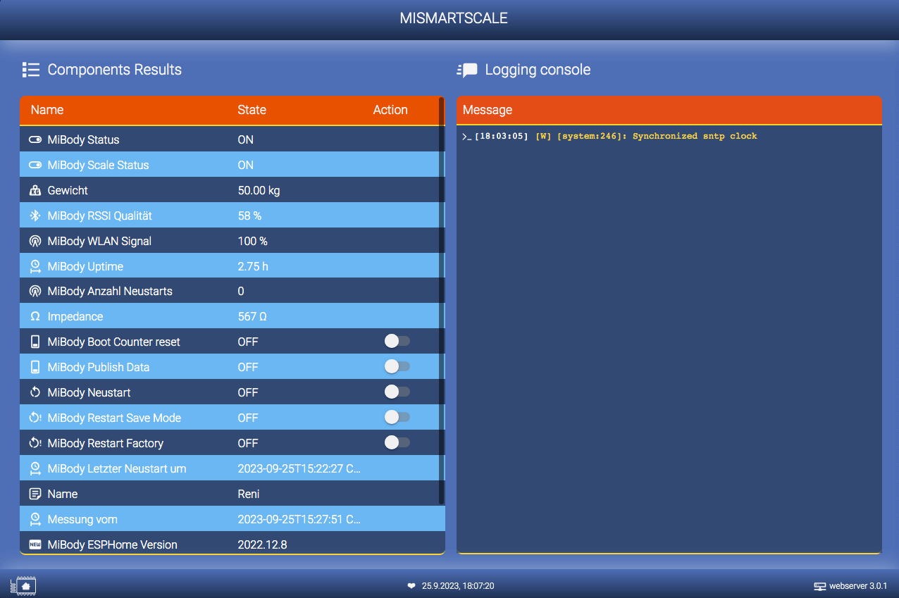

# Mi Smart Scale 2 on ESP32 (ESPHome)

[![License][license-shield]][license]
[![ESPHome release][esphome-release-shield]][esphome-release]
[![Open in Visual Studio Code][open-in-vscode-shield]][open-in-vscode]
[![Support author][donate-me-shield]][donate-me]

[license-shield]: https://img.shields.io/static/v1?label=License&message=MIT&color=orange&logo=license
[license]: https://opensource.org/licenses/MIT

[esphome-release-shield]: https://img.shields.io/static/v1?label=ESPHome&message=2022.12.8&color=green&logo=esphome
[esphome-release]: https://GitHub.com/esphome/esphome/releases/

[open-in-vscode-shield]: https://img.shields.io/static/v1?label=+&message=Open+in+VSCode&color=blue&logo=visualstudiocode
[open-in-vscode]: https://open.vscode.dev/zibous/ha-watermeter

[donate-me-shield]: https://img.shields.io/static/v1?label=+&color=orange&message=Buy+me+a+coffee
[donate-me]: https://www.buymeacoff.ee/zibous

The ESPHome application for Xiaomi Miscale 2.

### Requirements
- **ESPHOME** on Docker **2022.12.8**
- **ESP32** 240MHz, 520KB RAM, 4MB Flash (ESP32 AZ-DELIVERY-DEVKIT-V4)
   
- MQTT Brocker
- Mi Scale 2
   

 

## ESPHome Dashboard

 
## Folder `config`
All used components and configuration file for Mi Scale 2

## Folder `docker_install`
Bash scripts to install esphome on docker

## File `compile.sh`
Bash script to compile a esphome application with docker (2022.12.8)

 
## Body Composition Scale 2 (XMTZC05HM) Data to MQTT / Influxdb
Code to read weight measurements from Xiaomi Body Scales.

